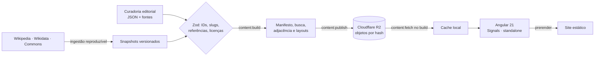

<p align="center">
  
</p>

<h3 align="center">Uma enciclopédia visual para explorar ideias e compreender suas conexões.</h3>

<p align="center">
  História, política, economia e sociedade como uma rede navegável de pessoas, obras, conceitos e acontecimentos, sempre com a fonte por perto.
</p>

<p align="center">
  
  
  
  
  
  
</p>

<p align="center">
  <a href="https://atlasbr.vercel.app">atlasbr.vercel.app</a>
</p>

---

## Estado do projeto

ATLAS está em construção. Nem todo o acervo foi revisado:

- Parte do conteúdo tem **revisão de IA**, ainda sem revisão humana. Essa condição aparece no próprio site.
- Lacunas e pendências são marcadas como tais, não preenchidas com texto genérico.
- A cobertura por tema é desigual entre as tradições.

Erros, fontes faltando e sugestões são bem-vindos (veja [Contribuir](#contribuir)).

## O que é

O ATLAS não organiza o conhecimento em artigos isolados. Cada grande tema é uma leitura contínua, e as palavras, retratos, linhas do tempo e grafos abrem novos caminhos sem tirar você do contexto.

| | |
| --- | --- |
| **Leituras contínuas** | Textos longos por tradição, em capítulos, com índice e fontes ao lado de cada afirmação. |
| **Acervo de verbetes** | Pessoas, obras, conceitos, acontecimentos e instituições, cada um com página permanente (`/verbete/:slug`). |
| **Rede de conhecimento** | Entidades com IDs estáveis e relações tipadas, reaproveitadas em todas as telas. |
| **Contexto por demanda** | Termos e nós abrem fichas com fontes por hover, foco, toque ou clique. |
| **Tipo de afirmação à vista** | Fato documentado, interpretação, controvérsia ou lacuna, sempre marcados. |

## Rotas principais

| Rota | Conteúdo |
| --- | --- |
| `/` | Página inicial, busca e entrada para as leituras |
| `/marxismo`, `/liberalismo` | Leituras contínuas por tradição |
| `/conhecimento` | Busca no acervo, com filtros que ficam na URL |
| `/rede` | Rede de ligações entre entidades (`/grafo` redireciona para cá) |
| `/verbete/:slug` | Ficha de uma entidade, com fontes e conexões |
| `/pessoas`, `/obras`, `/conceitos`, `/acontecimentos`, `/lugares`, `/fontes` | Listagens por tipo |

Caminhos desconhecidos mostram "Página não encontrada". `/comparar` redireciona para `/conhecimento`.

## Começar

Requer **Node.js 24** e **npm 11**.

```bash
npm install
npm start
```

Abra `http://localhost:4200`.

| Comando | Uso |
| --- | --- |
| `npm start` | Servidor de desenvolvimento |
| `npm run build` | Build de produção, prerender e cabeçalhos de segurança |
| `npm run preview` | Serve a saída estática em `127.0.0.1:4305` |
| `npm test` | Testes unitários (Vitest) |
| `npm run test:e2e` | Navegador, acessibilidade (axe) e estabilidade de layout (Playwright) |
| `npm run lint` | ESLint, limites arquiteturais, Biome e Prettier |
| `npm run typecheck` | TypeScript da aplicação e dos testes |
| `npm run check:links` | Verifica links internos da saída estática |
| `npm run content:build` | Compila `content` nos artefatos que o app carrega |

`start`, `build`, `test`, `lint` e `typecheck` executam `content:build` antes. Depois de editar `content` com o servidor aberto, reinicie `npm start`.

## Como funciona



- O conteúdo compilado é publicado no R2 como objetos imutáveis (`c/<sha256>.json`, `m/<sha256>.<ext>`). Apenas `pointer.json` muda.
- O build baixa a versão fixada em `content/content-pointer.json`, verificando tamanho e SHA-256.
- O app lê o ponteiro e os objetos por hash, sem API em tempo de leitura.
- Publicar (`npm run content:publish`) exige credenciais do R2 fora do repositório. Quem só lê ou contribui com código não precisa delas.

## Estrutura

```
content/            grafo, dossiês, traduções e ponteiro do conteúdo publicado
src/app/core/       contratos Zod, repositório de conteúdo, consultas puras
src/app/features/   ideologies · exploration · study
src/app/shared/     UI e diretivas reutilizáveis
src/app/layouts/    shell e rodapé
scripts/            build de conteúdo, ingestão Wikimedia, verificações
docs/               arquitetura, design, editorial e qualidade
```

Antes de contribuir, leia a [arquitetura](docs/architecture/ARCHITECTURE.md), o [padrão de páginas](docs/design/PAGE_STANDARD.md) e o [índice da documentação](docs/README.md).

## Princípios editoriais

- Fato, interpretação, hipótese e controvérsia são marcados como tais.
- Nenhuma fonte, data, citação ou revisão humana é inventada. Lacunas aparecem como lacunas.
- Linhas de crítica não são linhas de descendência. Proximidade em uma visualização não sugere causalidade.
- Imagens só são publicadas com autoria e licença registradas junto a elas.

## Contribuir

Encontrou um erro, uma fonte melhor ou uma conexão que falta? [Abra uma issue](https://github.com/bellussi1/ATLAS/issues) ou leia o [guia de contribuição](CONTRIBUTING.md). Pull requests devem passar `lint`, `typecheck`, `test`, `test:e2e` e `build`.

## Licença

A definir. Até que haja um arquivo `LICENSE`, o código e o conteúdo não têm licença de reuso concedida.

## Créditos

Imagens do [Wikimedia Commons](https://commons.wikimedia.org), com autoria e licença registradas em cada uma. Dados de descoberta da Wikipedia e do Wikidata, lidos de snapshots versionados. Tipografia IBM Plex e Source Serif 4 sob a SIL Open Font License.
