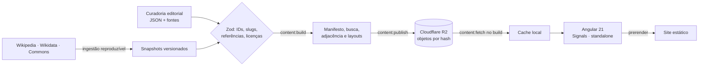

<p align="center">
  
</p>

<h3 align="center">Uma enciclopédia visual para explorar ideias e compreender suas conexões.</h3>

<p align="center">
  História, política, economia e sociedade como uma rede navegável de pessoas, obras, conceitos e acontecimentos, sempre com a fonte por perto.
</p>

<p align="center">
  
  
  
  
  
  
  
  
</p>

<p align="center">
  <a href="https://atlas-bellussi.pages.dev">atlas-bellussi.pages.dev</a>
</p>

---

## Estado do projeto

ATLAS está em construção. Nem todo o acervo foi revisado:

- Parte do conteúdo tem **revisão de IA**, ainda sem revisão humana. Essa condição aparece no próprio site.
- Lacunas e pendências são marcadas como tais, não preenchidas com texto genérico.
- A cobertura varia entre as tradições e as entidades.

Erros, fontes faltando e sugestões são bem-vindos (veja [Contribuir](#contribuir)).

## O que é

O ATLAS não organiza o conhecimento em artigos isolados. Cada grande tema é uma leitura contínua, e as palavras, retratos, linhas do tempo e grafos abrem novos caminhos sem tirar você do contexto.

| | |
| --- | --- |
| **Leituras contínuas** | Textos longos por tradição, em capítulos, com índice e fontes ao lado de cada afirmação. |
| **Acervo de verbetes** | Pessoas, obras, conceitos, acontecimentos, países, regimes, partidos, instituições e lugares, cada um com página permanente. |
| **Rede de conhecimento** | Entidades com IDs estáveis e relações tipadas, reaproveitadas em todas as telas. |
| **Contexto por demanda** | Termos e nós abrem fichas com fontes por hover, foco, toque ou clique. |
| **Tipo de afirmação à vista** | Fato documentado, interpretação, controvérsia ou lacuna, sempre marcados. |

## Rotas

| Rota | Conteúdo |
| --- | --- |
| `/` | Página inicial: busca universal, entrada para as leituras e mesa de pesquisa |
| `/leitura/:slug` | Leituras contínuas por tradição (`/marxismo`, `/liberalismo`, `/social-democracia` e `/anarquismo` redirecionam) |
| `/acervo` | Busca no acervo, com filtros que ficam na URL |
| `/entidades`, `/ideologias`, `/pessoas`, `/obras`, `/fontes`, `/paises`, `/regimes`, `/partidos`, `/instituicoes`, `/acontecimentos`, `/conceitos`, `/lugares` | Catálogos por tipo |
| `/grafos` | Mapa de ligações em tela cheia (`/grafo` e `/rede` redirecionam para cá) |
| `/verbete/:slug` | Página permanente de uma entidade, com contexto, fontes e conexões |

`/conhecimento` e `/comparar` redirecionam para `/acervo`. Caminhos desconhecidos mostram "Página não encontrada", sem redirecionar.

As rotas publicadas são prerenderizadas no build. Leituras e verbetes não publicados não entram no prerender.

## Começar

Requer **Node.js 24** e **npm 11**.

```bash
npm install
npm start
```

Abra `http://localhost:4200`.

| Comando | Uso |
| --- | --- |
| `npm start` | Servidor de desenvolvimento (`ng serve`) |
| `npm run build` | Build de produção, prerender e cabeçalhos de segurança |
| `npm run preview` | Serve a saída estática em `127.0.0.1:4305` |
| `npm test` | Testes unitários (Vitest) |
| `npm run test:e2e` | Jornadas no navegador, acessibilidade (axe) e estabilidade de layout (Playwright) |
| `npm run test:content` | Testes dos scripts de build de conteúdo |
| `npm run test:ingestion` | Testes da ingestão Wikimedia |
| `npm run lint` | ESLint, limites arquiteturais, Biome e Prettier |
| `npm run typecheck` | TypeScript da aplicação e dos testes |
| `npm run check:links` | Verifica links da saída estática |
| `npm run verify` | Pipeline completo: auditoria, lint, testes, ingestão, build, links e E2E |
| `npm run content:build` | Compila `content` nos artefatos que o app carrega |

`start`, `build`, `test`, `lint` e `typecheck` executam `content:build` antes. Depois de editar `content` com o servidor aberto, reinicie `npm start`.

## Como funciona



- O conteúdo compilado é publicado no R2 como objetos imutáveis (`c/<sha256>.json`, `m/<sha256>.<ext>`). Só `pointer.json` é mutável.
- `content/content-pointer.json` fixa a versão publicada. O build (`content:fetch`) a baixa, verificando tamanho e SHA-256.
- O app lê o ponteiro e os objetos por hash, com integridade preservada na hidratação. Não há API em tempo de leitura.
- Publicar (`npm run content:publish`) exige credenciais do R2 fora do repositório. Quem só lê ou contribui com código não precisa delas.

## Estrutura

```
src/app/
  app.routes.ts       composição central das rotas
  core/
    content/          modelos Zod, repositório, consultas puras, editorial, mídia
    routing/          resolvers de conteúdo
  shared/
    ui/               componentes de apresentação reutilizáveis
    directives/       comportamento compartilhado (revelação, contexto, links editoriais)
    motion/           movimento compartilhado
  features/
    ideologies/       leituras de tradições: páginas, blocos, modelos, dados, serviço
    exploration/      catálogos, busca, rede, verbetes e visualizações históricas
    study/            trilha de estudo e progresso
  layouts/            app-shell, cabeçalho e rodapé
  pages/home/         página inicial
content/              grafo, ideologias, conhecimento, tradições e traduções (fonte versionada)
public/               marca, fontes, mídia, cabeçalhos e redirecionamentos
scripts/              build e publicação de conteúdo, ingestão Wikimedia, pipeline de tradições
e2e/                  jornadas no navegador
docs/                 arquitetura, design, editorial, pesquisa e qualidade
```

### Mapa da raiz

| Entrada | Papel | Versionada? |
|---|---|---|
| `src/`, `content/`, `public/`, `scripts/`, `e2e/` | Código, conteúdo-fonte, marca e pipeline | sim |
| `docs/` | Arquitetura, design, operação, pesquisas e histórico | sim |
| `referencias/` | Três imagens de direção de arte e o `LEIA-ME` | sim; não são ativos de publicação |
| `AGENTS.md`, `README.md`, `LICENSE*`, `SECURITY.md`, `CITATION.cff` | Contrato, apresentação, licenças e citação | sim |
| `angular.json`, `package*.json`, `tsconfig*.json`, `eslint.config.js`, `biome.json`, `*.config.*` | Configuração de build, tipos e qualidade | sim |
| `generated/` | Cache de conteúdo, respostas pagas, avaliações e capturas locais | não; recriável |
| `dist/`, `.angular/`, `node_modules/` | Saída de build, cache do Angular e dependências | não; recriável |
| `tmp/`, `output/` | Rascunhos de sessão e mídia de lançamento | não; local |
| `.claude/worktrees/` | Worktrees de sessões paralelas | não; podem ser removidos após o merge |
| `prompts/`, `templates/`, `animation-plans/` | Antigos artefatos de trabalho | agora em `docs/archive/2026-11/` e `docs/design/animation-plans/` |

Limpeza segura de build e testes: `npm run clean` mostra o que sairia; `npm run clean -- --yes` remove. O comando não toca em `content/`, `docs/`, `referencias/` nem em `output/`.

Regras de dependência: `core` não importa apresentação; `shared` não importa features; features não acessam a implementação interna umas das outras. Imports entre responsabilidades usam os aliases de `tsconfig.json`. A regra `architecture/boundaries` do ESLint verifica os limites e a ausência de ciclos.

Leia antes de contribuir: [arquitetura](docs/architecture/ARCHITECTURE.md), [padrão de páginas](docs/design/PAGE_STANDARD.md) e [índice da documentação](docs/README.md).

## Princípios editoriais

- Fato, interpretação, hipótese e controvérsia são marcados como tais.
- Nenhuma fonte, data, citação ou revisão humana é inventada. Lacunas aparecem como lacunas.
- Linhas de crítica não são linhas de descendência. Proximidade em uma visualização não sugere causalidade.
- Imagens só são publicadas com autoria e licença registradas junto a elas.

## Pipeline de conteúdo

Novas tradições e verbetes entram por uma pipeline com portas de verificação em cada estágio, e não por edição manual:

| Comando | Uso |
| --- | --- |
| `npm run tradicao -- <slug> --stage N --dry-run` | Roda um estágio da pipeline de uma tradição (estado retomável, sem gastar nada no `--dry-run`) |
| `npm run tradicao:coverage -- <slug>` | Mede o quanto falta para a tradição chegar ao piso de /marxismo e /liberalismo |
| `npm run ideology:new` | Cria o esqueleto de uma leitura |
| `npm run wiki:extract` | Extração de rascunhos a partir da Wikipedia (exige `ANTHROPIC_API_KEY`; os rascunhos ficam em um bucket privado) |
| `npm run ingest:fetch-raw` e `npm run ingest:verify` | Baixam as respostas brutas do R2 e reproduzem as capturas Wikimedia offline |
| `npm run content:publish` | Publica o conteúdo compilado no R2 (exige credenciais fora do repositório) |

A pipeline não publica sozinha: publicar é decisão humana. Conteúdo extraído com IA é marcado como revisão de IA até que uma pessoa o revise. Os estágios estão em `.claude/skills/atlas-pipeline-tradicao/SKILL.md`.

## Contribuir

Encontrou um erro, uma fonte melhor ou uma conexão que falta? [Abra uma issue](https://github.com/bellussi1/ATLAS/issues) ou leia o [guia de contribuição](CONTRIBUTING.md). Pull requests devem passar `lint`, `typecheck`, `test`, `test:e2e` e `build`.

Este projeto segue um [código de conduta](CODE_OF_CONDUCT.md). Vulnerabilidades: veja a [política de segurança](SECURITY.md).

## Licença

- **Código:** [MIT](LICENSE).
- **Conteúdo editorial, grafo e relações:** [CC BY-SA 4.0](LICENSE-CONTEUDO.md). Textos derivados da Wikipedia mantêm a licença de origem.
- **Imagens:** licença de cada arquivo do Wikimedia Commons, registrada junto a ela. Não são cobertas por este repositório.
- **Tipografia:** SIL Open Font License 1.1.

Detalhes, regras de reutilização e o aviso sobre conteúdo assistido por IA em [LICENSE-CONTEUDO.md](LICENSE-CONTEUDO.md). Para citar o projeto, use [CITATION.cff](CITATION.cff).

## Créditos

Imagens do [Wikimedia Commons](https://commons.wikimedia.org), com autoria e licença registradas em cada uma. Textos e dados de descoberta da Wikipedia (CC BY-SA 4.0) e do Wikidata (CC0), lidos de capturas reproduzíveis versionadas. Tipografia IBM Plex e Source Serif 4 sob a SIL Open Font License.
