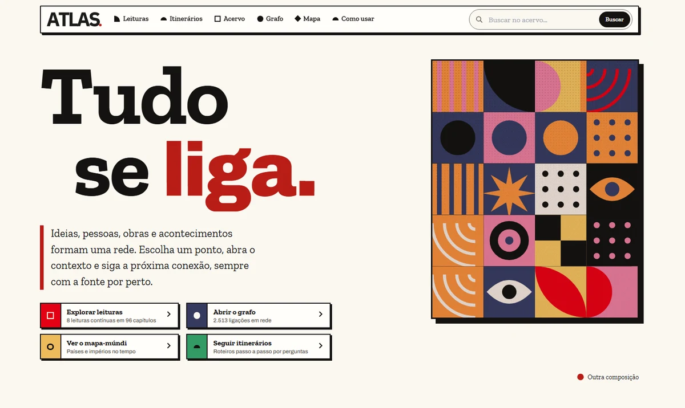
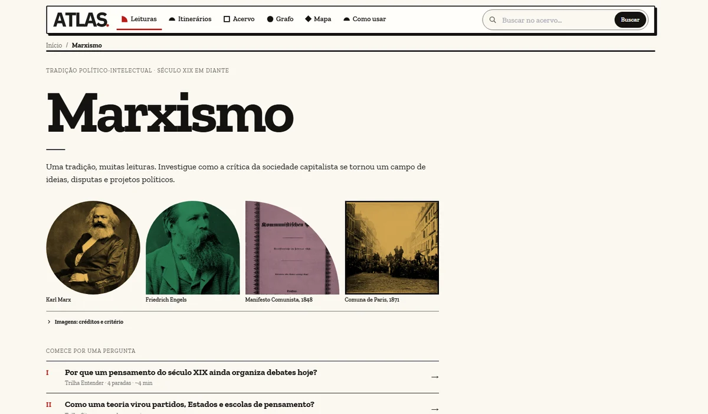
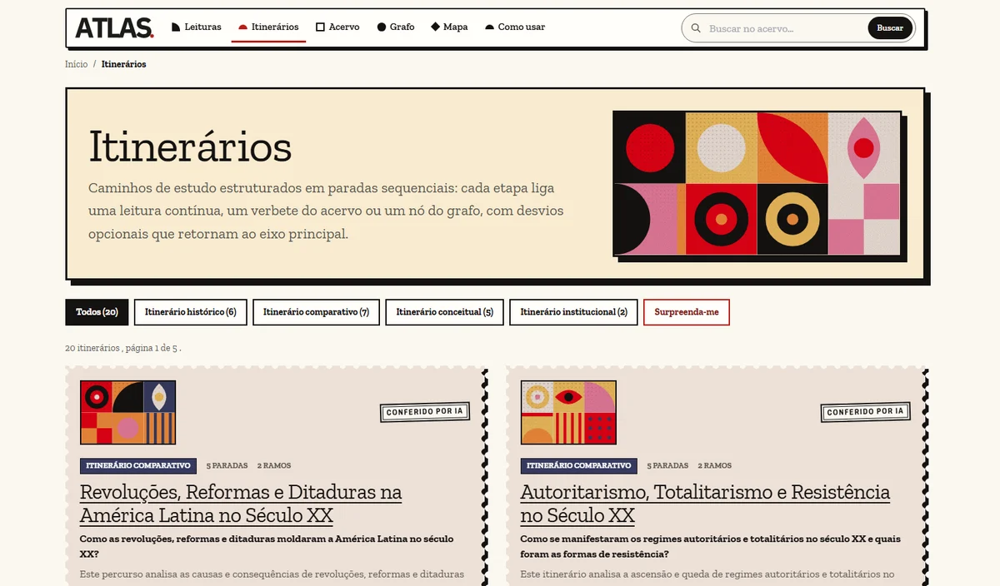
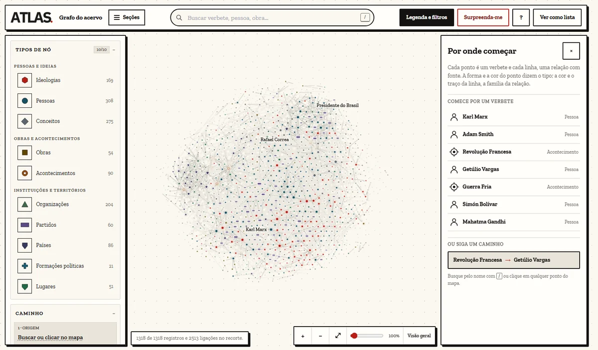
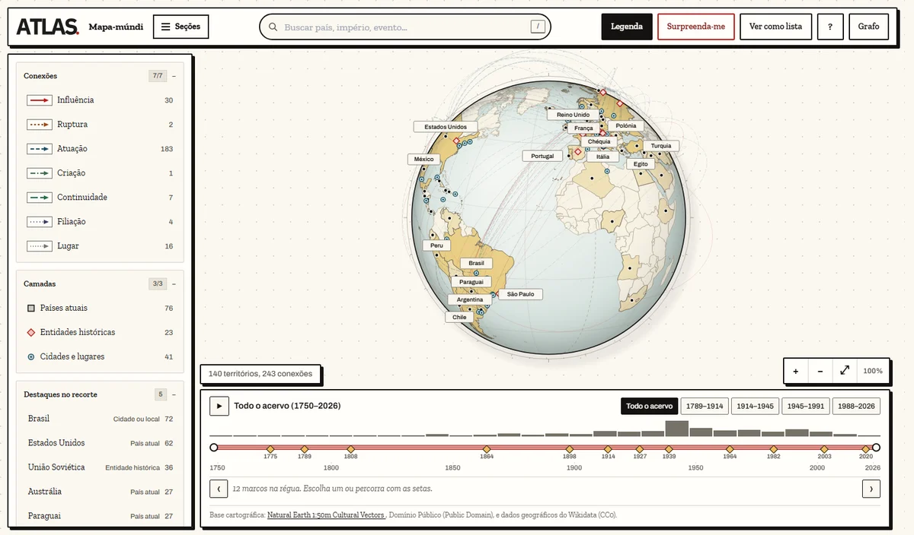
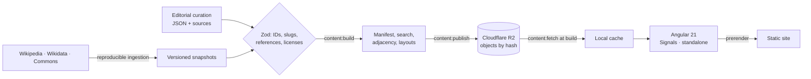

<p align="center">
  
</p>

<h3 align="center">A visual encyclopedia for exploring ideas and how they connect.</h3>

<p align="center">
  History, politics, economics and society as a navigable network of people, works, concepts and events, with the source always within reach.
</p>

<p align="center">
  <a href="https://atlas-bellussi.pages.dev"><b>atlas-bellussi.pages.dev</b></a> ·
  <a href="README.pt-BR.md">Português</a> ·
  <a href="CONTRIBUTING.md">Contribute</a>
</p>

<p align="center">
  
  
  
  
  
  
</p>

<p align="center">
  <a href="https://atlas-bellussi.pages.dev"></a>
</p>

---

## Why

Encyclopedic text tends to blend documented fact, attributed thesis and interpretation in one paragraph. Knowledge graphs that keep them apart are rarely readable by non-specialists. ATLAS aims at both: a reading experience for students and curious readers, backed by typed data a developer can audit.

Every claim is a record with its own citation and one of these classes:

| Class | Meaning |
| --- | --- |
| `documented-fact` | Supported directly by the cited source |
| `attributed-thesis` | A position held by a named author or school |
| `interpretation` | A reading of the evidence, marked as such |
| `contested-claim` | Disputed between credible sources |

Known gaps are declared at chapter level instead of being filled with generic text.

## The content, in numbers

From the published content release (graph of 2026-11-18):

| | |
| --- | --- |
| **1,320** entities | people, works, concepts, events, institutions, parties, places, ideologies |
| **12,146** claims | every one with a citation |
| **1,482** sources | |
| **3,025** typed relations | |
| **9** long-form readings, **20** itineraries | |

## Four ways into the same graph

| | |
| --- | --- |
|  | **Readings.** Continuous text in chapters, with portraits, sources beside the claims and questions to start from. |
|  | **Itineraries.** Step-by-step routes that link readings, entries and graph nodes. |
|  | **Graph.** The whole network, with node-type filters, search and paths between two entries. |
|  | **Map.** Countries, empires and cities on a globe, with a timeline from 1750 to 2026. |

## Project status

ATLAS is under construction and not everything has been reviewed.

- No claim has completed human review yet. Part of the content carries **AI review**, and the site says so.
- Gaps and pending items are marked as such.
- Coverage is uneven across traditions, and the interface is mostly in Portuguese.

Mistakes, missing sources and suggestions are welcome (see [Contributing](#contributing)).

## Run it locally

Requires **Node.js 24** and **npm 11**. No credentials are needed to read or contribute code.

```bash
npm install
npm start
```

Open `http://localhost:4200`. `npm run setup` prepares everything in one go (dependencies, content cache and build, optional local RAG environment); `npm run setup:check` only inspects the environment.

| Command | Use |
| --- | --- |
| `npm start` | Compile content and serve locally |
| `npm run build` | Production build, prerender and security headers |
| `npm test` | Unit tests (Vitest) |
| `npm run test:e2e` | User journeys, accessibility (axe) and layout stability (Playwright) |
| `npm run test:content` / `test:ingestion` | `node --test` suites for content and ingestion scripts |
| `npm run lint` | ESLint, architecture boundaries, Biome and Prettier |
| `npm run typecheck` | TypeScript for the app and the specs |
| `npm run verify` | Full pipeline: audit, lint, tests, ingestion, build, links and E2E |

## How it works



- **Static-first and content-addressed.** Compiled content is published to R2 as immutable objects (`c/<sha256>.json`, `m/<sha256>.<ext>`). Only `pointer.json` is mutable. The build fetches the pinned release, checking size and SHA-256, and prerenders every published route. There is no API at reading time.
- **Validated before it compiles.** Zod schemas check IDs, slugs, references and asset licenses.
- **Angular 21.** Signals, standalone components, and TransferState so hydration does not download content twice.
- **Enforced boundaries.** A custom ESLint rule (`architecture/boundaries`) keeps `core`, `shared` and features apart and blocks import cycles.
- **AI with guardrails.** LLM-assisted extraction keeps only citations found verbatim in the source; a local RAG pipeline (`bge-m3` embeddings and a reranker, run with Ollama) suggests relations as drafts; AI review is labelled as such. The pipeline never publishes: publishing is a human decision.

Read [architecture](docs/architecture/ARCHITECTURE.md), the [page standard](docs/design/PAGE_STANDARD.md) and the [docs index](docs/README.md) before contributing.

## Contributing

There are two ways in, and one needs no code.

**Content and sources (no code needed)**
- Found a wrong statement or a better source? Open a [content issue](https://github.com/bellussi1/ATLAS/issues/new/choose) with the entry and the source.
- Issues labelled `conteúdo`, `imagens` and `novo atlas` are the places to start.

**Code, design and accessibility**
- Pick an issue labelled [`good first issue`](https://github.com/bellussi1/ATLAS/labels/good%20first%20issue) or [`help wanted`](https://github.com/bellussi1/ATLAS/labels/help%20wanted), and comment before starting.
- Pull requests should pass `lint`, `typecheck`, `test`, `test:e2e` and `build`.
- Say in the PR what was generated or assisted by AI. AI review is never presented as human review.

Full guide in [CONTRIBUTING.md](CONTRIBUTING.md). This project follows a [code of conduct](CODE_OF_CONDUCT.md); report vulnerabilities through the [security policy](SECURITY.md).

## License

- **Code:** [MIT](LICENSE).
- **Editorial content, graph and relations:** [CC BY-SA 4.0](LICENSE-CONTEUDO.md). Text derived from Wikipedia keeps its original license.
- **Images:** the license of each Wikimedia Commons file, recorded next to it. Not covered by this repository.
- **Typography:** SIL Open Font License 1.1.

To cite the project, use [CITATION.cff](CITATION.cff).

## Credits

Images from [Wikimedia Commons](https://commons.wikimedia.org), with author and license recorded on each. Text and discovery data from Wikipedia (CC BY-SA 4.0) and Wikidata (CC0), read from reproducible versioned snapshots. IBM Plex and Source Serif 4 under the SIL Open Font License.
