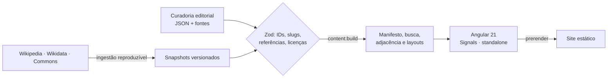

<p align="center">
  
</p>

<h3 align="center">Uma enciclopédia visual para explorar ideias e compreender suas conexões.</h3>

<p align="center">
  História, política, economia e sociedade como uma rede navegável de pessoas, obras, conceitos e acontecimentos, sempre com a fonte por perto.
</p>

<p align="center">
  
  
  
  
  
  
</p>

---

## Ler é explorar

O ATLAS não organiza o conhecimento em artigos isolados. Cada grande tema é uma publicação histórica contínua, em que palavras, retratos, linhas do tempo e grafos abrem novos caminhos sem tirar você do contexto.

| | |
| --- | --- |
| **Enciclopédia editorial** | Leituras longas por tradição, com capítulos, índice, progresso e retorno ao ponto anterior. |
| **Rede de conhecimento** | Pessoas, obras, conceitos, eventos e instituições com IDs estáveis e relações tipadas, reaproveitados em todas as telas. |
| **Exploração contextual** | Termos, fichas e nós abrem contexto com fontes por hover, foco, toque ou clique. |
| **Narrativa visual** | Escala do tempo interativa, rede compilada, comparadores e motion que comunica seleção e continuidade. |
| **Conhecimento verificável** | Cada afirmação distingue fato documentado, interpretação, controvérsia e lacuna, e indica onde conferir. |

## O que já dá para explorar

| Rota | Experiência |
| --- | --- |
| `/` | Cartaz de entrada, busca universal, capas das leituras e ferramentas de investigação |
| `/marxismo` | 10 capítulos: origens, conceitos, pensadores, escala do tempo, épocas, lugares, vertentes, críticas e fontes |
| `/liberalismo` | Atlas exploratório com índice de entidades, rede, cronologia e imagens licenciadas |
| `/rede` | Rede de conhecimento com geometria compilada no build, filtros e evidências por vínculo |
| `/comparar` | Dois registros lado a lado, em modo conceitual ou histórico, com método e limites explícitos |
| `/conhecimento` | Busca universal com filtros compartilháveis por URL |
| `/verbete/:slug` | Página permanente de cada entidade, com contexto, fontes e conexões |

## Identidade

Modernismo suíço, jornalismo visual, cartografia histórica e museografia digital. Papel quente, tinta quase preta e vermelho de ação, com ocre, verde, rosa e índigo usados com propósito. Mosaicos geométricos originais (SVG determinístico) assinam cada rota sem fingir dados. Tipografia local: IBM Plex Sans, IBM Plex Mono e Source Serif 4.

As interações são projetadas para mouse, teclado e toque, respeitam `prefers-reduced-motion` e evitam deslocar o layout; os testes E2E medem isso nas rotas principais.

## Como funciona



Sem backend nem API em tempo de leitura: o conteúdo é compilado antes do build, validado e carregado de arquivos locais com hash e TransferState. A mesma entidade alimenta leituras, rede, comparador e verbete sem duplicar informação histórica.

## Começar

Requer Node.js 24 e npm 11.

```bash
npm install
npm start
```

| Comando | Uso |
| --- | --- |
| `npm start` | Servidor local com recarga |
| `npm run build` | Build de produção, prerender e cabeçalhos de segurança |
| `npm test` | Testes unitários (Vitest) |
| `npm run test:e2e` | Navegador, acessibilidade (axe) e estabilidade de layout (Playwright) |
| `npm run lint` | ESLint, limites arquiteturais, Biome e Prettier |
| `npm run typecheck` | TypeScript da aplicação e dos testes |
| `npm run content:build` | Compila `src/content` nos artefatos que o app carrega |
| `npm run preview` | Serve a saída estática em `127.0.0.1:4305` |

Os comandos `start`, `build`, `test`, `lint` e `typecheck` executam `content:build` antes. Depois de editar `src/content` com o servidor aberto, reinicie `npm start`.

## Estrutura

```
src/
  content/            grafo, dossiês, traduções (fonte da verdade editorial)
  app/core/           contratos Zod, repositório de conteúdo, consultas puras
  app/features/       ideologies · exploration · study
  app/shared/         UI e diretivas reutilizáveis (mosaico, reveal, contexto)
  app/layouts/        shell e rodapé
  app/pages/home/     página inicial
scripts/              build de conteúdo, ingestão Wikimedia, verificações
docs/                 arquitetura, design, editorial e qualidade
```

Leia [Arquitetura](docs/architecture/ARCHITECTURE.md), [Padrão de páginas](docs/design/PAGE_STANDARD.md) e o [índice da documentação](docs/README.md) antes de contribuir.

## Princípios editoriais

- Fato, interpretação, hipótese e controvérsia são marcados como tais.
- Nenhuma fonte, data, citação ou revisão humana é inventada; lacunas aparecem como lacunas.
- Linhas de crítica não são linhas de descendência; proximidade em uma visualização não sugere causalidade.
- Imagens só são publicadas com autoria e licença registradas junto a elas.

## Contribuir

Encontrou um erro, uma fonte melhor ou uma conexão que falta? [Abra uma issue](https://github.com/bellussi1/ATLAS/issues) com a referência. Pull requests devem passar `lint`, `typecheck`, `test`, `test:e2e` e `build`.

## Créditos

Imagens do [Wikimedia Commons](https://commons.wikimedia.org), com autoria e licença registradas em cada uma. Dados de descoberta da Wikipedia e do Wikidata, lidos de cópias locais versionadas. Tipografia IBM Plex e Source Serif 4 sob a SIL Open Font License.
