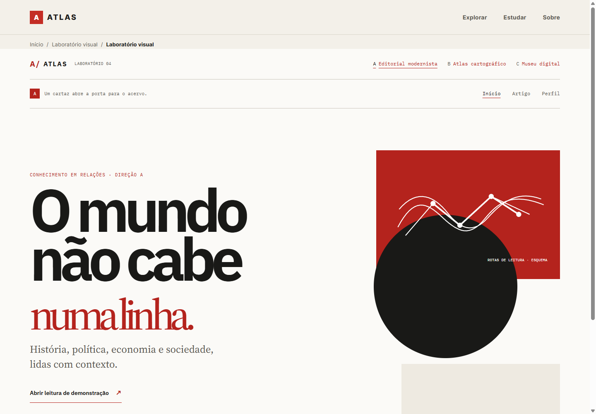
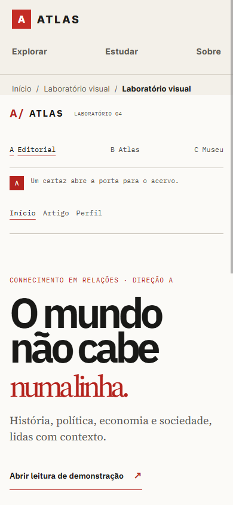
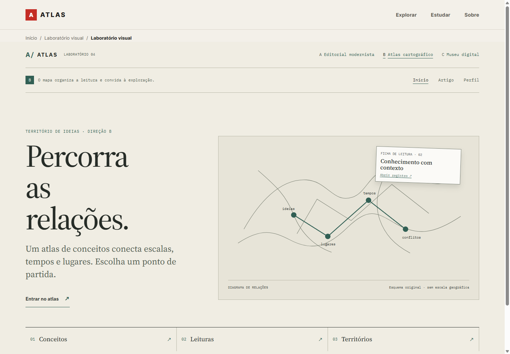
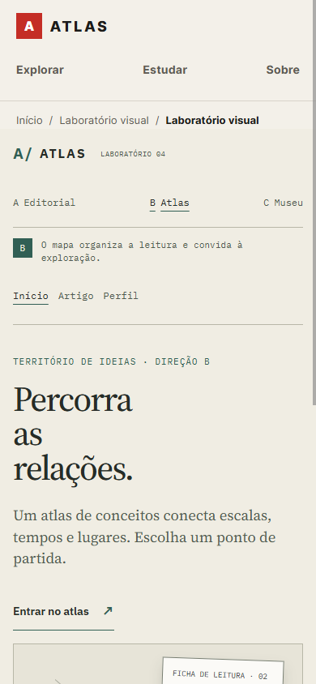
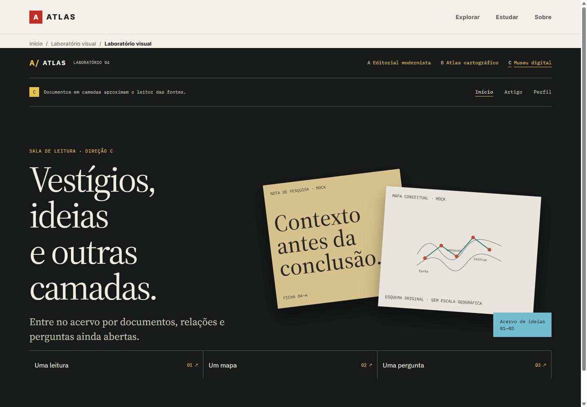
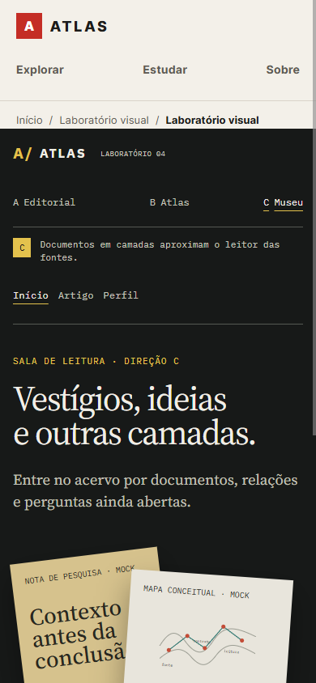

# Direção artística — arquivo histórico do Prompt 04

Este arquivo preserva o histórico das três composições experimentais criadas no Prompt 04. As rotas `/laboratorio/:proposta/:pagina` foram retiradas da aplicação e já não são publicadas; os desenhos e capturas abaixo servem apenas como registro da evolução visual. A direção A foi escolhida pelo usuário e consolidada na interface principal.

## Evolução atual — enciclopédia exploratória

Em novembro de 2026, a direção editorial ganha exploração contextual no Marxismo e infraestrutura compartilhada com Liberalismo. Papel, tinta, filetes, tipografia local e campos cromáticos continuam organizando leitura e evidência. A geometria comunica seleção e relação: trilho temporal, rede de nós, quadro de posições e fichas sobrepostas. Evitar que o detalhe empurre o parágrafo ou transforme uma polêmica em árvore de descendência. Hover, foco e toque revelam contexto; a pista de ação já existe antes da interação. O contrato atualizado está em [PAGE_STANDARD.md](PAGE_STANDARD.md), e capturas e medições em [auditoria-enciclopedia/RELATORIO.md](auditoria-enciclopedia/RELATORIO.md).

As especificações abaixo registram decisões históricas. O carregamento atual das fontes usa `optional`, e as únicas páginas publicadas são home, Marxismo e Liberalismo.

## Observação das referências

As observações abaixo descrevem somente o que aparece nos arquivos fornecidos em `referencias/`. As propostas de adaptação vêm em seguida e não reproduzem essas peças.

| Arquivo | Atributos visíveis na referência | Decisões registradas nas propostas |
| --- | --- | --- |
| `01-modernismo-suico-cartaz.png` | Cartaz vertical em papel branco; hierarquia sans em blocos alinhados à esquerda; título monumental em linhas curtas; pequenos filetes separam título e informações; retângulo vermelho alto, círculo preto e bloco preto ocupam uma coluna assimétrica. | As três propostas adotam escala tipográfica e alinhamento por grid, cada uma em uma composição própria. Nenhum texto, marca ou arranjo literal foi reproduzido. |
| `02-atlas-historico-editorial.png` | Livro aberto fotografado de cima; mapa antigo ocupa a página direita; página esquerda combina mapa menor, fotografias, legendas, títulos e texto em colunas estreitas; margens amplas, fólio e papel envelhecido dão ritmo de livro. | Cada proposta tem um diagrama cartográfico esquemático acompanhado de legenda ou metadados; as páginas de artigo também usam margem editorial. Os desenhos são originais e não alegam representar geografia histórica. |
| `03-arquivo-digital-experimental.png` | Fundo escuro de exposição; serifas grandes e texto monoespaçado; navegação com Explore/Timeline/Map/Collections e busca; breadcrumb e controles visíveis de lista/grade; fotografia central e documentos inclinados se sobrepõem em camadas; metadados identificam conjunto e data; etiqueta lateral apresenta área de leitura; ações aparentes de baixar e fechar; cartões azul, amarelo e vermelho criam contraste. A imagem permite observar affordances, mas não confirmar o comportamento delas. | As três propostas ligam páginas demonstrativas e registros do acervo com links nomeados. A adiciona metadados e uma faixa de entradas; B sobrepõe uma ficha clicável ao diagrama; C compõe fichas em profundidades distintas com etiquetas de coleção. Os documentos são simulações CSS/SVG, sem cópia de ativos da referência. |

## As três composições

- **A — editorial modernista com atlas e acervo:** hierarquia sans e formas assimétricas de cartaz; uma rota conceitual branca e sua legenda entram no retângulo vermelho; a faixa inferior navega pelos registros existentes do acervo. O artigo acrescenta margem e metadados editoriais; o perfil mantém grid geométrico.
- **B — atlas cartográfico com exploração museográfica:** o diagrama relacional e sua legenda organizam a home como uma página de atlas; uma ficha editorial clicável, inclinada e em primeiro plano leva a um artigo existente. O artigo segue uma rota entre evidência, contexto e interpretação; tipografia monoespaçada e um documento sobreposto trazem a camada museográfica.
- **C — museu digital experimental com rigor tipográfico suíço e páginas de leitura:** grid assimétrico e escala tipográfica disciplinam a composição; mapa conceitual legendado aparece dentro de uma ficha; folhas simuladas se sobrepõem em profundidade com entradas clicáveis para o acervo. Artigo usa margem, serifas de leitura e inserto de arquivo. O papel claro continua nas propostas A e B, sem impor o fundo escuro ao produto.

Na implementação original, cada alternativa continha início, artigo e perfil em `/laboratorio/a|b|c/inicio|artigo|perfil`. Essas rotas foram removidas. As páginas demonstrativas de artigo e atlas levavam a registros de metodologia; a personagem “Pesquisadora de Exemplo” e seus campos eram fictícios e estavam marcados como mock.

## Sistema visual e acessibilidade

| Proposta | Tokens completos usados | Contrastes medidos das combinações de texto e informação gráfica |
| --- | --- | --- |
| A — papel | papel `#FBFAF7`; superfície secundária `#EEEAE1`; tinta `#191917`; apoio `#57544E`; filete `#C9C4BA`; vermelho `#B4231D`; branco cartográfico `#FFFFFF`. | Tinta/apoio/vermelho sobre papel: 16,87:1 / 7,23:1 / 6,29:1. Traço e legenda brancos no bloco vermelho: 6,56:1. Iniciais decorativas sobre a superfície secundária: 14,66:1. |
| B — cartografia | papel `#F0EDE3`; superfície `#E2DECE`; tinta `#262C27`; apoio `#515B50`; filete `#B8B7A7`; verde `#315F54`; campo cartográfico `#E7E4D8`; contorno/foco/ficha `#777D70`; legenda `#42473F`; rótulos do mapa `#343A34`; ficha `#FBFAF7` com tinta `#252B26`. | Tinta/apoio/verde sobre papel: 12,18:1 / 6,05:1 / 6,19:1. Texto da legenda e rótulos do mapa: 7,48:1 / 9,16:1. Tinta da ficha: 13,85:1. Contorno cartográfico: 3,33:1; rota verde no campo cartográfico: 5,69:1; contorno/foco sobre a ficha: 4,06:1; iniciais verdes sobre a superfície secundária: 9,33:1. |
| C — exposição | fundo `#171918`; superfície/ficha de perfil `#252826`; tinta `#F1EEE6`; apoio `#C2C2B9`; filete `#555953`; amarelo/foco `#E4C24D`; azul `#72BDD0`; vermelho pontual `#C34C37`; ficha ocre `#D6C28D`/tinta `#292820`; ficha de mapa `#E8E5DC`/tinta `#30322D`; linha cartográfica `#777B70`; rota `#2D756F`. | Tinta/apoio/amarelo sobre fundo escuro: 15,24:1 / 9,85:1 / 10,20:1. Tinta das fichas ocre, clara e azul: 8,43:1 / 10,29:1 / 7,50:1. Contorno do mapa na ficha clara: 3,44:1; rota: 4,29:1; pontos vermelhos: 3,78:1; iniciais claras no perfil: 12,84:1. |

As razões foram calculadas pela luminância sRGB. A escala mínima de texto normal usada para revisão foi 4,5:1; contornos informativos e foco, 3:1. A primeira revisão encontrou contorno cartográfico de B abaixo de 3:1; a cor foi escurecida para `#777D70` e o valor acima foi recalculado. A legenda segue visível junto à informação por cor. O foco de teclado tem contorno de 3px, os links de navegação expõem `aria-current`, e `prefers-reduced-motion: reduce` remove rolagem suave, transições e animações. As três propostas mantêm nomes compactos visíveis na navegação mobile e nomes completos acessíveis. Os layouts empilham colunas abaixo de 52rem e foram conferidos sem rolagem horizontal em todas as nove páginas a 320px e nas capturas de 390px.

### Tipografia e licenças

- **IBM Plex Sans:** títulos e interface; arquivo variável, com fallback `Segoe UI`/sans-serif.
- **Source Serif 4:** textos de leitura e títulos editoriais; arquivo variável, com fallback Georgia/serif.
- **IBM Plex Mono:** metadados e legendas, com fallback Consolas/monospace.

Os três arquivos estão licenciados sob SIL Open Font License 1.1. As cópias dos avisos completos estão junto aos arquivos em `public/fonts/`. Fontes são servidas localmente e carregadas com `font-display: swap`, evitando requisição remota. A pilha tipográfica aprovada permanece a mesma no produto.

## Capturas

As seis capturas abaixo são imagens reais do navegador em 1440×1000 e 390×844 CSS pixels. Foram salvas sem as imagens fornecidas como ativos do produto.

| Proposta | Desktop | Mobile |
| --- | --- | --- |
| A — editorial modernista |  |  |
| B — atlas cartográfico |  |  |
| C — museu digital |  |  |

As capturas mostram apenas a home de cada proposta, como registro comparativo de direção de arte. Artigo e perfil foram páginas funcionais na implementação original e não estão mais disponíveis como rotas.

## Limites e avaliação

As fichas, o mapa esquemático, a marca de perfil e as informações sobre a pessoa eram elementos de protótipo, não fontes históricas. A implementação original pré-renderizava dez rotas (índice e nove páginas demonstrativas). As rotas e o componente foram retirados; o orçamento de CSS caiu de 19/20 kB para 7/8 kB em `angular.json`, suficiente para as folhas atuais sem alertas. A direção A permanece na produção; B e C ficam registradas abaixo como alternativas históricas, sem função de produto.

Licença: [IBM Plex — licença oficial](https://github.com/IBM/plex/blob/master/LICENSE.txt), [IBM Plex no catálogo Google Fonts](https://github.com/google/fonts/tree/main/ofl/ibmplexsans), [Source Serif 4 — OFL](https://github.com/google/fonts/blob/main/ofl/sourceserif4/OFL.txt).

## Consolidação da direção A

A interface principal adota modernismo editorial com fundo claro quente, vermelho, preto, tipografia expressiva e serifas de leitura. As novas referências fornecidas pelo usuário reforçam ritmo tipográfico, geometria e composição museográfica, sem autorização implícita para publicar essas imagens.

A homepage passa a oferecer busca e três modos: **Relações**, **Tempo e espaço** e **Conhecimento**. Cada modo possui uma rota própria com navegação entre modos. A home deixa de concentrar recursos em miniatura e prioriza iniciar uma investigação na primeira tela. Os limites de dados e as interações disponíveis estão documentados em SISTEMA-DE-DESIGN.md.

Capturas reais da versão consolidada: [desktop](direcao-artistica/screenshots/home-desktop.png) e [mobile](direcao-artistica/screenshots/home-mobile.png).

## Referência Stitch escolhida: Exploração do Conhecimento Histórico

O usuário escolheu a tela af5d2dc3ee024405ba33e0408ae71d2e do projeto Stitch 15545419207416735639 como referência principal da homepage. A adaptação adota terminal de busca, metadados, grade aparente, rede selecionável com ficha contextual, índice de leituras e percursos por perguntas. Os três modos continuam acessíveis por navegação própria. As fontes locais licenciadas do ATLAS permanecem; não foram importados recursos remotos de tipografia ou imagens do protótipo.

A composição foi adaptada ao acervo validado, que agora inclui entidades e relações documentadas do processo constituinte de 1987–1988, além de registros de metodologia. Datas, coordenadas, citações, volumes, métricas de acervo, licenças documentais e selos de conformidade do protótipo Stitch não foram transferidos. A interface de cronologia e mapas não é representada como disponível; os registros mostram suas fontes e estado editorial. O Prompt 05.5 anexado não foi executado como tarefa independente.

A rede é um componente compartilhado por home e Relações; seleção, filtro de categoria, conexões destacadas, ficha e modo de lista usam os mesmos dados e comportamentos. Capturas desta adaptação: [desktop](direcao-artistica/screenshots/home-stitch-desktop.png) e [mobile](direcao-artistica/screenshots/home-stitch-mobile.png).

A exportação local code.html, DESIGN.md e screen.png, fornecida durante a implementação, corresponde ao laboratório de experiências e foi consultada como referência complementar de grade, nós, painéis e metadados. A escolha principal da homepage permanece a tela Exploração do Conhecimento Histórico. O HTML exportado não foi executado nem incorporado à aplicação.

## Reconstrução pela mesa de pesquisa

O usuário rejeitou a composição anterior por aparência genérica e solicitou instalação e aplicação de seis skills. A nova home abandona o terminal e a sequência de módulos: uma mesa reúne os três textos reais em fichas selecionáveis; o trecho, o destino de leitura e a prévia acompanham a seleção. O contexto editorial aparece em uma ficha vermelha. No celular, um seletor nativo substitui o índice lateral sem retirar as opções.

Paleta deliberadamente vinculada ao briefing: papel #FBFAF7, tinta #1C1C1A, vermelho #B4231D e suporte #ECEBE6. IBM Plex Sans estrutura a ficha; Source Serif 4 apresenta o trecho; IBM Plex Mono fica restrita aos metadados. A assimetria e a sobreposição vêm das referências de cartaz e acervo, sem publicar imagens ou fac-símiles não licenciados.

Na autocrítica, os desenhos dos modos foram removidos por não acrescentarem informação. Os acessos Relações, Tempo e espaço e Conhecimento continuam disponíveis. O leitor, o grafo completo e o showroom foram preservados; as páginas de laboratório foram despublicadas posteriormente. Este arquivo mantém o histórico de direção, sem manter aquelas telas no produto.

Skills instaladas em C:/Users/Bellussi/.codex/skills, com prefixo atlas- para preservar as instalações anteriores: frontend-design (anthropics/skills), interaction-design (wshobson/agents), animate, find-animation-opportunities e improve-animations (emilkowalski/skills), 12-principles-of-animation (raphaelsalaja/skills). Esta última foi recuperada da revisão 376dbc168120520309c15d6dc6abfc4d8be5a12b, anterior ao arquivamento. Os arquivos foram lidos e aplicados nesta execução; o catálogo de skills instalado também estará disponível nos próximos turnos.

Capturas atuais: [desktop](direcao-artistica/screenshots/research-table-desktop.png), [mobile](direcao-artistica/screenshots/research-table-mobile.png). A auditoria de movimento está em ../animation-plans/001-research-table-review.md.

## Evolução aprovada: editorial geométrico

Após aprovar a mesa, o usuário solicitou uma skill própria, mais cores, termos vermelhos navegáveis e elementos geométricos. A base da mesa foi preservada. Os novos motivos identificam os formatos reais de leitura; verde, ocre, rosa e índigo ampliam a paleta sem transformar toda a página em uma colagem. As cinco novas referências de cartazes e composições geométricas foram usadas como inspiração, sem cópia de imagens na aplicação.

A skill atlas-editorial-geometrico está versionada em .agents/skills e instalada no catálogo local. Capturas desta evolução: [desktop](direcao-artistica/screenshots/geometric-editorial-desktop.png) e [mobile](direcao-artistica/screenshots/geometric-editorial-mobile.png).

## Assinatura e pôster navegável

O usuário pediu mais liberdade gráfica, cor e tipografia, incluindo header e footer. O header agora combina a assinatura ATLAS em peso forte, três portas geométricas para os modos e a navegação principal em uma coluna lateral no desktop. No celular, os elementos fluem sem menu oculto.

O footer usa índigo, letras em grande escala e um mosaico navegável que reaproveita os motivos de verbete, artigo e atlas. O botão Outra composição alterna três arranjos de transformações dos desenhos. Os rótulos e destinos não mudam, e a ordem do teclado é estável. É uma brincadeira gráfica identificada como composição, não uma visualização histórica.

Nenhuma dependência ou orçamento de bundle foi adicionado. A assinatura e os desenhos são SVG/CSS locais. A mesa aprovada permanece no centro da home. A skill própria foi atualizada e sincronizada com a instalação local.

Capturas desta extensão: [desktop](direcao-artistica/screenshots/graphic-shell-desktop.png) e [mobile](direcao-artistica/screenshots/graphic-shell-mobile.png).

## Marca e ícone da aba

A escolha final do usuário é a assinatura tipográfica ATLAS com ponto vermelho, conforme as referências enviadas. As letras foram aproximadas para transmitir conexão, com ajustes de espaço entre os pares e preservação dos vazios internos. O símbolo separado à esquerda foi retirado. Header e footer usam respectivamente a assinatura principal e a versão inverse, mantendo os nomes acessíveis dos links.

Os SVGs contêm contornos vetoriais derivados de public/fonts/IBMPlexSans.ttf, peso 700, com espaçamento ajustado; não carregam fontes nem imagens externas. A fonte local está sob SIL Open Font License 1.1, com aviso e licença em [OFL-IBM-Plex.txt](../public/fonts/OFL-IBM-Plex.txt). Os PNGs são exportações auxiliares; os originais SVG são a fonte para novas escalas.

Arquivos em public/brand:

- atlas-logo.svg e atlas-logo.png: assinatura principal com fundo transparente.
- atlas-logo-inverse.svg: letras brancas e ponto vermelho para fundo escuro.
- atlas-logo-mono.svg: assinatura inteiramente em tinta.
- atlas-logo-white.svg: assinatura inteiramente branca.
- atlas-symbol.svg e atlas-symbol.png: A tipográfico e ponto vermelho.
- favicon.svg e favicon-32.png: A e ponto vermelho sobre papel para a aba.
- apple-touch-icon.png: redução em 180×180 px.

O arquivo public/favicon.ico contém PNGs de 16, 32 e 48 px. A [prancha da marca](brand/atlas-identity.png) reúne assinatura, símbolo, redução e versão para fundo escuro; o [original vetorial](brand/atlas-identity.svg) também está disponível.

O caminho antigo public/atlas-mark.svg passa a servir a redução atual, preservando a URL anterior. Os links no index usam caminhos absolutos à raiz para funcionar nas rotas internas. Não foi adicionado manifest, service worker ou fluxo de instalação.

A rasterização usou resvg em uma pasta temporária de ferramentas, sem dependências novas na aplicação. O favicon e a marca são estáticos para reconhecimento em escala pequena; as interações do acervo continuam sendo o espaço principal de experimentação.

A skill própria foi ampliada para incorporar novas referências como uma biblioteca viva e manter experimentação com tipografia, peso, cor, hover, transições, âncoras e scroll. As skills de animação orientam oportunidade, execução e revisão; o controle de rolagem, o foco e reduced motion continuam preservados.

Verificação desta entrega: 104 testes passaram; build com 36 rotas estáticas, lint e typecheck passaram. No Chrome, a página ficou sem overflow horizontal em 320 e 1440 px; os quatro arquivos de ícone responderam HTTP 200. Esses checks não representam uma auditoria completa de acessibilidade ou de compatibilidade entre navegadores.
